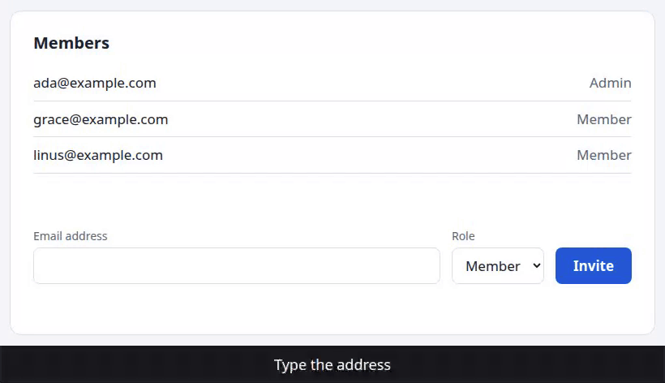
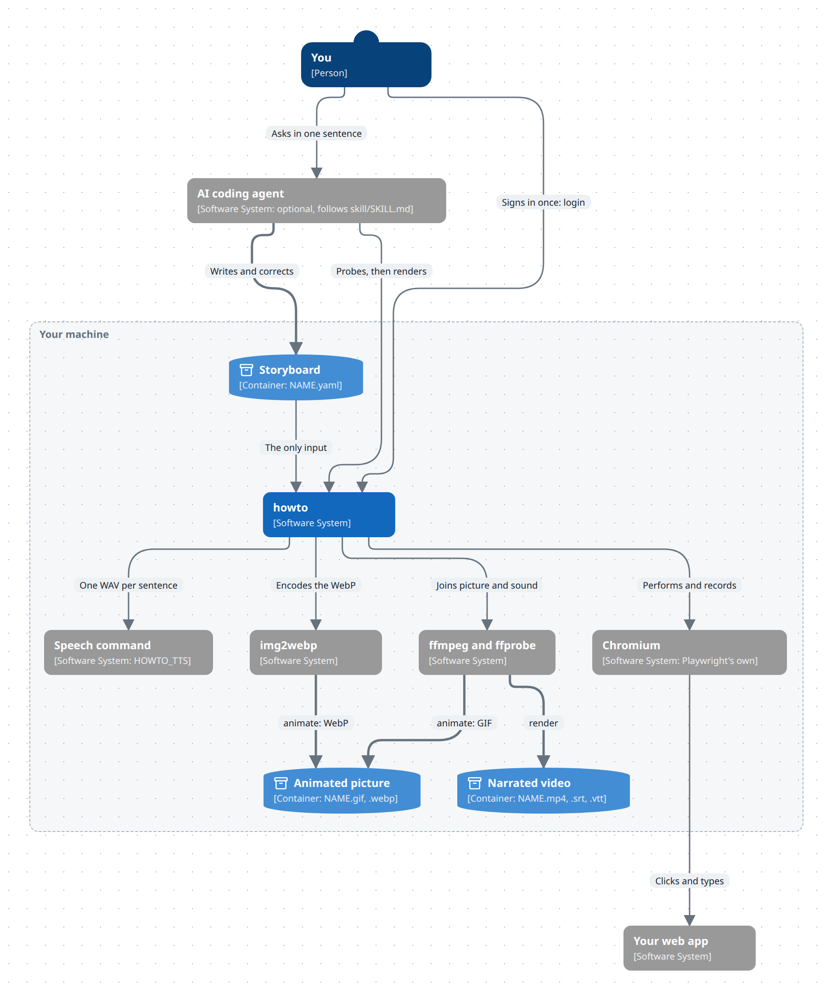

# howto

[](https://github.com/Ferroman/howto/actions/workflows/test.yml)

`howto` turns a storyboard, a YAML file of steps and narration, into a narrated how-to video of a web app: an MP4 with SRT and WebVTT subtitles. From the same kind of file it makes a short animated picture, a GIF and a WebP, to illustrate documentation.



`howto animate` made that picture from [examples/invite-picture.yaml](examples/invite-picture.yaml). `howto render` made [this narrated video](docs/media/invite.mp4) from [examples/invite.yaml](examples/invite.yaml).

- **A storyboard is the only input.** It names each control as a person would, `{role: button, name: Invite}`, and says what to tell the viewer at each step. `howto` performs it in a browser of its own, records it and speaks the narration.
- **An AI agent can write the storyboard.** [skill/SKILL.md](skill/SKILL.md) teaches an agent the format. The agent explores your app with `howto probe`, which prints a text outline of the page, so a model without image input is enough. `howto` itself calls no model.
- **Everything runs on your machine.** The browser is Playwright's Chromium. The speech comes from a command that you choose, and two come with `howto`.
- **A change is cheap.** Each sentence is spoken once and kept, so a changed sentence costs one sentence, and a render is repeatable.

## Status

This is version 0.1.

- **Linux only so far.** It is developed on an Ubuntu 24.04 system, and the tests run on Ubuntu. macOS and Windows are untried.
- **Narration is in English.**
- **Web apps only.** Whatever runs in a browser tab can be filmed. Desktop programs cannot.

## How it fits together



`howto` does its work through other programs, and all of them run on your machine.

- **Chromium** performs the storyboard on your web app and records it.
- **The speech command** speaks each sentence of the narration. An animated picture needs none.
- **ffmpeg**, with `ffprobe`, joins the recording and the narration into the video, and builds the GIF.
- **`img2webp`** encodes the WebP, and nothing else needs it.

The agent is optional: a person writes a storyboard in the same way, with `howto probe`. [docs/internals.md](docs/internals.md#the-parts) shows the parts inside `howto`.

## Requirements

- [`uv`](https://docs.astral.sh/uv/), which builds the Python environment
- `ffmpeg` and `ffprobe`
- `img2webp`, from the `webp` package, for the WebP of an animated picture. Without it, `howto animate --format gif` still works
- A speech command, for narration. See [Speech](#speech). An animated picture needs none

## Install

```bash
git clone https://github.com/Ferroman/howto.git
cd howto
bash install.sh
```

The installer builds `~/.local/share/howto/venv`, downloads Playwright's Chromium (about 300 MB), and links three commands into `~/.local/bin`: `howto`, `howto-tts-kokoro` and `howto-tts-audiocpp`. When Claude Code is installed, it also links the skill into `~/.claude/skills`. It is safe to run again.

`~/.local/bin` has to be on your `PATH`. On a system that lacks the libraries Chromium needs, run `~/.local/share/howto/venv/bin/playwright install-deps chromium` once.

## Quick start

The repository has a small demo page and two storyboards for it. Serve the page in one terminal:

```bash
python3 -m http.server 8000 --directory examples/site
```

In another, make the animated picture. It needs no speech:

```bash
howto animate examples/invite-picture.yaml
```

```
examples/invite-picture.gif  820x472  9.4 s  564 KB
examples/invite-picture.webp  820x472  9.4 s  240 KB
```

For the narrated video, set up a speech command first. The quickest is Kokoro, described [below](#kokoro):

```bash
export HOWTO_TTS=howto-tts-kokoro
howto render examples/invite.yaml
```

```
examples/invite.mp4
examples/invite.srt
examples/invite.vtt
```

## A storyboard

```yaml
title: Invite a teammate
url: http://localhost:8000/
steps:
  - chapter: Invite a teammate
  - say: Open Settings, where the members of the workspace are managed.
    do:
      - click: {role: button, name: Settings}
  - say: Type your teammate's email address, and choose a role.
    do:
      - fill: {label: Email address, value: sam@example.com}
      - select: {label: Role, option: Admin}
  - say: Then press Invite. Your teammate appears in the list of members.
    do:
      - arrow: {role: button, name: Invite, note: Sends the invitation}
      - click: {role: button, name: Invite}
```

- **`say`** is the narration of a step, and **`do`** is what happens on the page while it is spoken.
- **`howto probe FILE`** runs the steps without recording and reports the first one that fails, with an outline of the page as it is then. That is how a storyboard is written, by a person or by an agent: probe, correct, probe again.
- **Marks** point at things: `box`, `circle`, `underline`, `arrow` and `spotlight`.
- **`zoom: 2`** enlarges the page around each control as it is used.
- **`crop`** cuts an animated picture to one part of the page.

[skill/SKILL.md](skill/SKILL.md) is the full reference of the format. [docs/guide.md](docs/guide.md) is the guide for a person.

## Let an agent write it

The skill in `skill/` is written for an AI coding agent. The installer links it for Claude Code. Give any other agent the file `skill/SKILL.md`. Then ask in one sentence:

> Make a how-to video: invite a teammate. Start at https://app.example.com, profile demo.

The agent writes the storyboard, probes it until every step works, and renders it.

**Every probe and every take performs its actions for real**, and an agent probes many times. Point it at a demo workspace or a test account, never at real data. For an app that needs a sign-in, run `howto login NAME URL` once: a browser window opens, you sign in, and the session stays in a profile that a storyboard names with `profile: NAME`.

## Speech

`howto` speaks through a command. It runs `tts` when `HOWTO_TTS` is not set, and it calls the command in three ways:

```
COMMAND -l en -o FILE TEXT                                    a sentence
COMMAND -l en -o FILE --clone WAV --clone-text WORDS TEXT     a sentence in the voice of a clip
COMMAND -l en -o FILE --design DESCRIPTION TEXT               a new voice, from a description
```

The command writes a WAV file and exits with 0. Any program that does this can be the speech command, and the first form alone is enough for a video without a `voice:`. Two commands come with `howto`:

| Command | Engine | Voices | Needs |
|---|---|---|---|
| `howto-tts-kokoro` | [Kokoro](https://huggingface.co/hexgrad/Kokoro-82M), through [kokoro-tts](https://github.com/nazdridoy/kokoro-tts) | Preset voices, chosen with `--voice` | A processor, and 350 MB of models |
| `howto-tts-audiocpp` | [audio.cpp](https://github.com/0xShug0/audio.cpp) | One plain voice, and voices that you design | A graphics card helps. 0.4 GB of models, and 5.3 GB more for voices |

### Kokoro

```bash
sudo apt install libportaudio2        # Debian and Ubuntu, when it is missing
uv tool install --python 3.12 kokoro-tts
curl -L --create-dirs -o ~/.local/share/howto/kokoro/kokoro-v1.0.onnx \
    https://github.com/thewh1teagle/kokoro-onnx/releases/download/model-files-v1.0/kokoro-v1.0.onnx
curl -L --create-dirs -o ~/.local/share/howto/kokoro/voices-v1.0.bin \
    https://github.com/thewh1teagle/kokoro-onnx/releases/download/model-files-v1.0/voices-v1.0.bin
export HOWTO_TTS=howto-tts-kokoro
```

`kokoro-tts` needs the PortAudio library. A desktop system usually has it, and a server or a container usually lacks it.

To have another voice, name it in the command: `HOWTO_TTS="howto-tts-kokoro --voice am_michael"`. `kokoro-tts --help-voices` lists them. The voice is an option because `howto` names each spoken clip after the command that spoke it, so another voice is spoken anew and nothing stale is played.

On a 16-core processor a sentence takes about two seconds, nearly all of it the start of the program: 20 seconds of speech took five.

### audio.cpp

Download a release of [audio.cpp](https://github.com/0xShug0/audio.cpp/releases) for your machine and the models from [its model repository](https://huggingface.co/audio-cpp/audio.cpp-gguf), into one folder:

| File under the folder | Used for | Size |
|---|---|---|
| `audiocpp_cli` | Everything | |
| `models/Supertonic-3-GGUF/supertonic-3-q8_0.gguf` | A sentence without a `voice:` | 0.4 GB |
| `models/Qwen3-TTS-12Hz-1.7B-Base-GGUF/qwen3-tts-12hz-1.7b-base-q8_0_v2.gguf` | A sentence in a voice | 2.6 GB |
| `models/Qwen3-TTS-12Hz-1.7B-VoiceDesign-GGUF/qwen3-tts-12hz-1.7b-voicedesign-q8_0.gguf` | `howto voice`, which makes a voice | 2.7 GB |

```bash
export AUDIOCPP_DIR=~/audio.cpp
export HOWTO_TTS=howto-tts-audiocpp
```

The engine chooses between the processor and a graphics card by itself. `AUDIOCPP_BACKEND=cpu AUDIOCPP_THREADS=16` keeps it on the processor, which is faster than a weak graphics card: a cloned voice took two to three seconds for a second of speech on 16 cores, and four on integrated graphics. `howto-tts-audiocpp --help` lists the other variables.

### Voices

With a speech command that can design and clone, which `howto-tts-audiocpp` can, you describe a narrator in plain words:

```bash
howto voice narrator "A calm, friendly man in his thirties with a clear American accent"
```

Listen to `~/.local/share/howto/voices/narrator.wav`, and run it again with `--replace` and other words until it is right. Then put `voice: narrator` at the top of a storyboard. [This video of a diagram editor](docs/media/diagc-explore.mp4) is narrated in such a voice.

The voice is designed once, as a short clip, and every sentence is then a clone of that clip. Sending the description with each sentence does not work: the model invents a new speaker every time. A recording of a real speaker works as well: put a few seconds in `NAME.wav` and its words in `NAME.yaml` as `text: ...`.

### The models have licences of their own

`howto` is MIT, and it contains no model. Kokoro and Qwen3-TTS are Apache-2.0. Supertonic 3 is under an OpenRAIL-M licence with use restrictions. Read the licence of the model you choose.

## Commands

| Command | What it does |
|---|---|
| `howto probe STORYBOARD` | Runs the steps with no recording and prints an outline of the page. `--until N`, `--within LOCATOR`, `--show` |
| `howto render STORYBOARD` | Writes `NAME.mp4`, `NAME.srt` and `NAME.vtt` next to the storyboard. `--out DIR` |
| `howto animate STORYBOARD` | Writes `NAME.gif` and `NAME.webp`, which loop without sound. `--format`, `--width N`, `--out DIR` |
| `howto narrate STORYBOARD` | Speaks the narration only and writes `NAME.narration.wav` |
| `howto voice NAME DESCRIPTION` | Makes a voice from a description. `howto voice` lists the voices, and `howto voice NAME` shows one |
| `howto login PROFILE URL` | Opens a browser window for a person to sign in. The session stays in the profile |

Exit codes: 0 for success, 1 for a step, the narration or the assembly that failed, 2 for a storyboard or a command line that is wrong, and 130 for a run that was stopped.

## Environment variables

| Variable | Default | Meaning |
|---|---|---|
| `HOWTO_TTS` | `tts` | The speech command, with its options |
| `HOWTO_FFMPEG`, `HOWTO_FFPROBE` | Homebrew on Linux, then `PATH` | The ffmpeg programs |
| `HOWTO_IMG2WEBP` | Homebrew on Linux, then `PATH` | The program that writes an animated WebP |
| `HOWTO_ACTION_TIMEOUT` | `10` | Seconds an element gets to appear |
| `HOWTO_DATA_DIR` | `~/.local/share/howto` | Browser profiles, voices and Kokoro's models |
| `HOWTO_CACHE_DIR` | `~/.cache/howto` | Spoken clips and intermediate files |

## More

- [docs/guide.md](docs/guide.md): how to make a video and a picture, how to choose a voice, and the things that surprise.
- [docs/internals.md](docs/internals.md): how the zoom, the marks, the pictures and the voices work, and why.
- [skill/SKILL.md](skill/SKILL.md): the storyboard format, written for an agent.

## Tests

```bash
uv run --extra test playwright install chromium   # once
uv run --extra test pytest                        # unit tests and browser tests
bash install.test.sh                              # the installer, in a sandbox
```

Without Chromium the browser tests are skipped, which is not a pass.

## Licence

[MIT](LICENSE).
