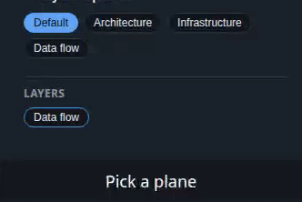

# Making videos and pictures with howto

This guide is for the person who wants the video. [The README](../README.md) says how to install `howto`, and [the speech page](speech.md) how to set up a speech command. [The skill](../skill/SKILL.md) is the reference of the storyboard format, written for the agent that writes it.

## Make a video

1. If the app needs a sign-in, sign in once, in the window that opens, then close the window:

   ```bash
   howto login demo https://app.example.com
   ```

2. Ask your agent for the video. Give it the task in one sentence, the start address and the profile name. For example: "Make a how-to video: invite a teammate. Start at https://app.example.com, profile demo."

3. The agent writes `videos/NAME.yaml`, probes it until every step works, and renders it. The video and the subtitles appear next to the storyboard.

4. Watch the video. To change a sentence or a step, edit the storyboard, or ask the agent to, and run `howto render` again. Only a changed sentence is spoken again.

The profile must be signed in to a demo workspace or a test account. Every probe and every take performs its actions for real, and the agent probes many times.

You can write the storyboard yourself in the same way: write a step, run `howto probe`, read which step failed and what the page holds, and correct it.

## Make the controls readable

If the controls are too small to read in the video, ask the agent for zoom, or add `zoom: 2` at the top of the storyboard yourself, and render again. The picture then moves in on each control as it is used and back out to show the result. A single step can set its own `zoom`, and `zoom: 1` keeps that step wide.

A smaller window helps as well: `viewport: 1280x720` instead of the default `1920x1080`.

## Point at things

Ask the agent for highlights, arrows or drawings, or add marks to a step's `do` list yourself. `circle`, `box`, `underline` and `spotlight` take an element as `click` does, and `arrow` also takes a few words in `note`:

```yaml
- say: Press Invite to add a teammate.
  do:
    - arrow: {role: button, name: Invite, note: Starts an invitation}
    - click: {role: button, name: Invite}
```

A mark stays until the next click, key press or choice from a list in its step, or until the step's narration ends. Each one makes its step about a second longer.

## Choose a voice

Without anything else, a video is narrated in the voice of the speech command. With `howto-tts-kokoro` you choose one of Kokoro's voices in the command itself: `HOWTO_TTS="howto-tts-kokoro --voice am_michael"`.

With a speech command that can design a voice and clone it, such as [`howto-tts-audiocpp`](speech.md#audiocpp), you describe a narrator in plain words and listen to the result:

```bash
howto voice narrator "A calm, friendly man in his thirties with a clear American accent"
```

The clip is `~/.local/share/howto/voices/narrator.wav`. Run the command again with `--replace` and other words until the voice is right. Then name it at the top of a storyboard, or ask the agent to:

```yaml
voice: narrator
```

- **`howto voice` lists your voices**, and `howto voice NAME` shows one with its description.
- **The first render in a new voice speaks every sentence again.** With Qwen3-TTS on a processor that takes two to three times as long as the narration lasts. After that only a changed sentence is spoken.
- **The voice is made once.** The description gives a short clip, and every sentence of every video is a clone of that clip. So the narrator stays the same from sentence to sentence and from video to video.
- **A recording of a real speaker works too.** Put a few seconds in `~/.local/share/howto/voices/NAME.wav`, and the words spoken in it in `NAME.yaml` as `text: ...`.

Qwen3-TTS speaks English and nine other languages. `howto` narrates in English only.

## Make an animated picture

Ask the agent for an animated picture or a GIF of one small task, and say which part of the page it is about. For example: "Make an animated picture for the docs: invite a teammate in the Members panel. Start at http://localhost:8000/#settings."

The agent writes a short storyboard and runs `howto animate` on it. You can also write one yourself. This one is [examples/invite-picture.yaml](../examples/invite-picture.yaml):

```yaml
title: Invite a teammate
url: http://localhost:8000/#settings
viewport: 1280x720
crop: {role: region, name: Members}
setup:
  - wait_for: {role: heading, name: Settings}
steps:
  - note: Type the address
    do:
      - fill: {label: Email address, value: sam@example.com}
  - note: Choose a role
    do:
      - select: {label: Role, option: Admin}
  - note: Press Invite
    do:
      - circle: {role: button, name: Invite}
      - click: {role: button, name: Invite}
    pause: 2
```

```bash
howto animate examples/invite-picture.yaml
```

```
examples/invite-picture.gif  820x472  9.4 s  564 KB
examples/invite-picture.webp  820x472  9.4 s  240 KB
```

- **Nothing is spoken.** `say` is ignored, so `note` and the marks explain what happens. A step lasts as long as its actions and its `pause`.
- **`crop` cuts the picture to one element**, with the notes in a dark strip under it. Without `crop` the picture is the whole window scaled down to 960 pixels, where the text of most apps is too small to read.
- **End with a pause**, so the viewer sees the result before the loop starts again.
- **The GIF plays everywhere. The WebP is about a third of its size.** `--format gif` or `--format webp` writes one of them.
- **To look at a picture**, open it in a browser.

`howto render` on the same storyboard ignores `crop` and films the whole window, so one file can give both a video and a picture.

A picture of a real app, cropped to one panel of a diagram editor:



## Which model writes the storyboard

`howto` calls no model. The agent that follows the skill does the thinking. A probe prints text only, so a model without image input is enough, and a model that runs on your own machine has written working storyboards from one sentence.

## Things that surprise

- **The pointer is on screen only around each action.** Playwright draws it, with a highlight on the target, for half a second before a click, a hover or typing, and hides it in between.
- **Ctrl+C runs `cleanup` and exits with 130.** A termination signal sent to the whole process group, which is what a shell's time limit usually sends, closes the browser before `cleanup` can run. Run `howto probe` on the storyboard afterwards: a probe ends with `cleanup`.
- **A browser dialog is dismissed, and a new tab is not followed.** A probe reports both in a `note:` line. A step behind a `confirm()` therefore does nothing.
- **A page with parts pinned to the window is not zoomed.** The zoom is the page enlarging itself. On a page that scrolls as a whole, that would move a pinned header or dialog, so `howto` keeps such a page wide and a probe prints `note: zoom is skipped on ...`. Apps that fill the window and scroll inside themselves zoom fine.
- **A mark hangs on an element, never on a position.** `howto` chooses the side an arrow comes from by asking the page where it is emptiest. A mark does not follow a page that scrolls, so a scroll takes the marks away.
- **A crop is one fixed part of the window.** It is measured once, after `setup`, and does not follow its element. A panel that grows during the steps is cut off, and a page that scrolls moves away under the crop. Crop to an element that keeps its place and its size, and put what changes the layout into `setup`.
- **A probe says what a crop leaves out.** `note: click role=button name="Fit View": the element is not inside the crop` means the picture would not show that click.
- **The WebP needs `img2webp`**, from the `webp` package. Without it `howto animate` stops before the browser starts, and `--format gif` works with ffmpeg alone.
- **A picture is 0.2 seconds shorter than its take.** The recorder's first frame comes before the strip for the notes is drawn, so the start of the recording is left out.
- **`howto voice NAME ... --replace` changes every video that names the voice**, at its next render. The clips of the earlier voice stay in the cache, but its clip is gone, and the same description does not give the same voice twice.
- **Values are typed as written.** `value: 02134` types 02134. YAML's own reading (octal numbers, `Yes` as true, dates) is switched off for a storyboard.
- **A profile is a signed-in session on your disk.** `howto login` makes its folder, `~/.local/share/howto/profiles/NAME`, readable by you alone. To remove the session from the machine, delete the folder.
- **`cleanup` runs after every probe and take in which `setup` completed.** Use it to undo what the steps did.
- **An element gets 10 seconds to appear.** `HOWTO_ACTION_TIMEOUT` changes that for a slow app.
- **A failed render keeps the earlier video.** The outputs are renamed into place only when all three exist. The same holds for the pictures of `howto animate`.
