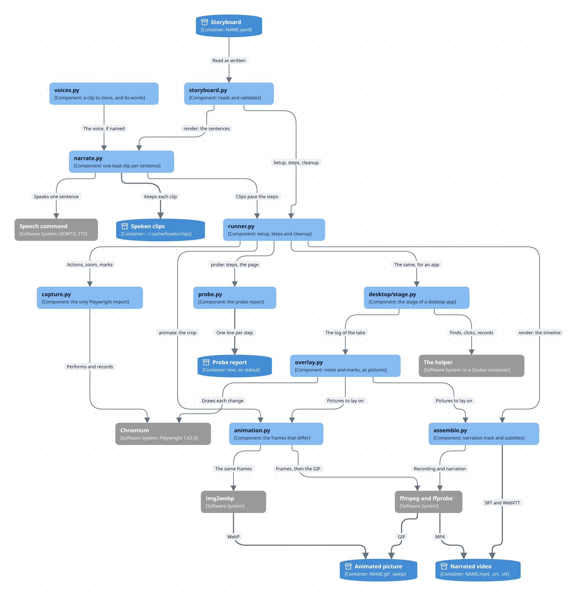

# How howto works

This page is for someone who changes `howto`, or who wants to know why it behaves as it does. [The README](../README.md) says how to use it, and [the guide](guide.md) how to make a video.

## The parts

An arrow is what one part hands to the next. `cli.py` calls the parts in this order and passes each result on. Along these arrows, only `runner.py` calls the next part itself: it drives `capture.py` through the `Stage` protocol, and the tests put `FakeStage` in its place.

`howto probe`, `howto render` and `howto animate` share most of the picture. A label that starts with the name of one of them marks a path that only that one takes. `howto narrate` goes as far as `narrate.py`, and then has `assemble.py` write the narration track alone.

The picture leaves out the helpers that several parts share: `timeline.py`, `zoom.py`, `marks.py`, and `tools.py`, which runs the other programs.

- **A storyboard is read as written.** `storyboard.py` validates it, and switches YAML's own reading of values off: `value: 02134` types 02134, and a button named `Yes` stays a name.
- **The narration is spoken first**, one clip for each sentence, by the speech command. A clip is named after a hash of the command, the language, the sentence and the voice, and kept in `~/.cache/howto/clips`. A speech failure therefore stops a render before the browser starts.
- **The browser is Playwright's Chromium**, and the recording is Playwright's own. `runner.py` performs the steps and waits for each sentence to end, so the picture and the narration are timed against one clock.
- **ffmpeg puts the two together**, and the subtitles are written from the same timeline.
- **`playwright` is pinned to one release**, 1.63.0. Its recorder writes 25 frames a second with no option to change it. `capture.py` uses three details of that release that no option covers: it hides the label the recorder writes on every action, through an internal element name (`x-pw-title`); it removes an overlay by leaving its `with` block, because `close()` does nothing in that release's synchronous API; and the marks depend on its overlay stylesheet, as described below. Raise the pin on purpose and run the browser tests.

## Zoom

`zoom: 2` in a storyboard enlarges the picture around each control as it is used, and goes back to the whole page at the end of the step. [the skill](../skill/SKILL.md) says how to write it.

- **The page enlarges itself.** The zoom is a transform on `<body>` that the browser animates and then draws again at the new size, so the text stays sharp. The recorder gives no more pixels than the page has, so cutting a part out of the recording afterwards would only blur it.
- **The pointer, the highlight and the note keep their size.** Playwright draws them outside `<body>`.
- **A page with parts pinned to the window is not zoomed.** A transform makes the body the box that `position: fixed` elements are placed in. On a page whose body is the window, which is how most apps are built, nothing moves. On a page that scrolls as a whole, a pinned header or a dialog would jump. The tool measures every element before it enlarges anything, keeps the picture wide when one of them would move, and says so in a `note:` line of the probe.
- **A probe zooms as well**, at once and with no waiting, so that it meets the page as the take will.

## Marks

Five actions draw on the picture instead of acting on the page: `box`, `circle`, `underline`, `arrow` and `spotlight`. Each names an element as `click` does. [the skill](../skill/SKILL.md) says how to write them.

- **A mark is an overlay of the recorder**, like the note: an SVG in screen pixels, outside `<body>`. A stroke appears as if drawn because a CSS animation uncovers it. The recorder removes scripts from an overlay, so nothing in a mark runs one.
- **A mark goes around what the viewer sees of an element.** A locator by text often names a block as wide as the page while its words are not. An element that shows no box of its own (no background, border or shadow, and not a control or a picture) is therefore measured by what is in it.
- **A mark does not move with the page.** Whatever moves the picture takes the marks away first: a scroll, and a zoom that has to go somewhere else. While a mark is shown and the next target is already in the picture, the picture holds still.
- **A mark goes as a click, a key press or a choice from a list lands**, so that none is left on a page that no longer has its target, or in front of what the action changed. Marks that are still there at the end of a step's actions stay until the narration of the step ends.
- **An arrow comes from the emptiest side.** There are eight candidates, the one that faces the middle of the picture first. The page is asked how many points of each lie on a control, a picture or text, and the lowest count wins.
- **Marks fade through a custom property.** They are in a closed shadow root that the page cannot reach, but `--howto-marks` on `<html>` is inherited there, and the marks take their opacity from it.
- **A probe draws nothing.** It looks for the element of each mark and scrolls to it, as the take will.

Two details depend on the pinned Playwright release. Its stylesheet sets every `svg` in the overlay layer to a height of 0, so the marks carry their size as an inline style. And it wraps an overlay in an element that its own stylesheet does not position, so each mark brings a positioned box of its own.

## Animated pictures

`howto animate` performs a storyboard without narration and writes `NAME.gif` and `NAME.webp`. `--format` chooses one of them, and `--width` (960 by default) scales a wider picture down. [the skill](../skill/SKILL.md) says how to write the storyboard.

- **The take is silent.** No speech command is needed and no title card is shown. A step lasts as long as its actions and its `pause`, and a note and the marks explain what happens.
- **`crop` cuts the picture to one element.** A window of 1920 pixels scaled down to the width of a document has text of five pixels. A part of the window at its own size stays readable, which matters more than the file format. `howto render` ignores `crop`.
- **The cut is known during the take, not made afterwards.** The recorder films the whole window and ffmpeg cuts the part out. The browser is told the part first, so that an arrow does not leave it and the notes go where the picture has them. A cut made later loses the note, which lies at the bottom of the window.
- **The notes get a strip of their own.** A note laid on a small crop covers what it explains. So the notes are written in a dark strip under the crop, as tall as the longest of them needs, and the picture is the crop and the strip together. At the bottom of the window the strip goes above the crop. A crop as tall as the window leaves no room, and there the strip is the lowest part of the crop, shown only while a note is.
- **An arrow is shorter in a small picture**: four tenths of the picture's shorter side, and 150 pixels at most.
- **The crop is one fixed part of the window**, measured once after `setup`, with 12 pixels around the element. Its corner and its size are even numbers, because ffmpeg cuts a recording at even pixels only. A zoom moves the page under it, so a storyboard with both is refused.
- **A probe reports the crop**, and names each action or mark whose element is outside it. The author is often a model that cannot look at the picture.
- **Only the frames that differ are kept.** ffmpeg samples 12.5 frames a second and writes a frame when the picture changed, named by its number. The distance to the next number is the time the frame is shown, and both encoders are given that time. A GIF encoder that drops repeated frames itself loses the pause at the end of the loop, because its last frame has no successor to take a time from.
- **The GIF has one palette and no dither.** Dither noise differs from frame to frame, so no frame repeats: a GIF of 2.6 MB was 1.9 MB without it, and 1.3 MB with the repeated frames dropped as well. The WebP is lossy and about three times smaller.
- **ffmpeg runs inside the folder of the frames**, and names the frames and their list without a path. It reads a `%` in the path of a frame as the place of a number, and release 6 puts the folder of the list in front of every frame in it. A work folder with a `%` in its name then broke the GIF on Ubuntu 24.04, while release 9 built it.
- **The first 0.2 seconds of the recording are left out.** The recorder takes its first frame before its overlays are drawn, so the strip is missing from it, and the picture would flash at every loop.

The pause was measured on a take of 9 seconds: with ffmpeg dropping the repeated frames, the GIF played for 6.9 seconds.

## Voices

A storyboard with `voice: NAME` is narrated in that voice. Without it, the speech command speaks in its own.

- **A voice is a clip and the words in it**: `NAME.wav` and `NAME.yaml` in `~/.local/share/howto/voices`. The clip says two sentences of a video, or the words of `--text`.
- **The voice is made once and cloned after that.** The speech command gets `--design DESCRIPTION` for the clip, and `--clone CLIP --clone-text WORDS` for every sentence of a video. Asking for the description again for each sentence does not work: a speech model that takes descriptions invents a speaker each time. Measured with Qwen3-TTS and a speaker-recognition model, where 1.0 is one speaker and two unrelated voices score 0.0 to 0.4: sentences designed one by one scored 0.10 to 0.44 against each other, and sentences cloned from one clip 0.64 to 0.84.
- **The voice is part of a clip's cache name**, as a hash of the clip and its words. A new voice speaks every sentence again, and going back to an earlier one speaks nothing.
- **`--replace` makes a voice anew.** Without it an existing voice stays, because every video that names it would speak differently.
- **A recording works too.** Put a few seconds of someone speaking in `NAME.wav` and the words in `NAME.yaml` as `text: ...`.
- **`howto animate` and `howto probe` do not need the voice.** Nothing is spoken in either.

## Stopping a run

Ctrl+C stops a probe, a render or an animation, runs the storyboard's `cleanup`, and exits with 130. The signal is acted on between browser calls, so the stop can take as long as one action's timeout.

A termination signal (SIGTERM) does the same when it is sent to `howto` alone. Sent to the whole process group, as a shell's time limit often does, it also reaches Playwright, which closes the browser at once: the run still ends with 130 and leaves no files behind, but `cleanup` cannot run. Run `howto probe` on the storyboard afterwards, because a probe ends with `cleanup`.

## Layout

| Path | Content |
|---|---|
| `src/howto/storyboard.py` | The storyboard format and its validation |
| `src/howto/narrate.py` | One cached clip per sentence |
| `src/howto/voices.py` | The voices: a clip to clone and the words in it |
| `src/howto/speech/` | The two speech commands that come with `howto`, for Kokoro and for audio.cpp |
| `src/howto/timeline.py` | The timing arithmetic |
| `src/howto/runner.py` | Setup, steps and cleanup, for a probe or a take |
| `src/howto/capture.py` | The Playwright browser. The only module that imports Playwright |
| `src/howto/zoom.py` | Which part of the page a zoom shows, and which part a crop cuts out |
| `src/howto/marks.py` | Where each mark is drawn, and its SVG |
| `src/howto/probe.py` | The probe report |
| `src/howto/assemble.py` | The narration track, ffmpeg and the subtitles |
| `src/howto/animation.py` | The GIF and the WebP of an animated picture |
| `src/howto/cli.py` | The commands |
| `skill/SKILL.md` | The storyboard format, written for an agent |
| `examples/` | A demo page and two storyboards for it |
| `spike/` | The measurements made before the build |
| `.diagrams/src/` | The diagrams of the README and of this page, as [diagc](https://github.com/Ferroman/diagc) sources. `diagc publish` writes the pictures to `.diagrams/static/` |
| `scripts/build_site.py` | Stages the documents for [the site](https://ferroman.github.io/howto/): their names there, their links, a player for each video and a link to each live diagram |
| `zensical.toml` | The name, the menu and the theme of the site, for Zensical |
